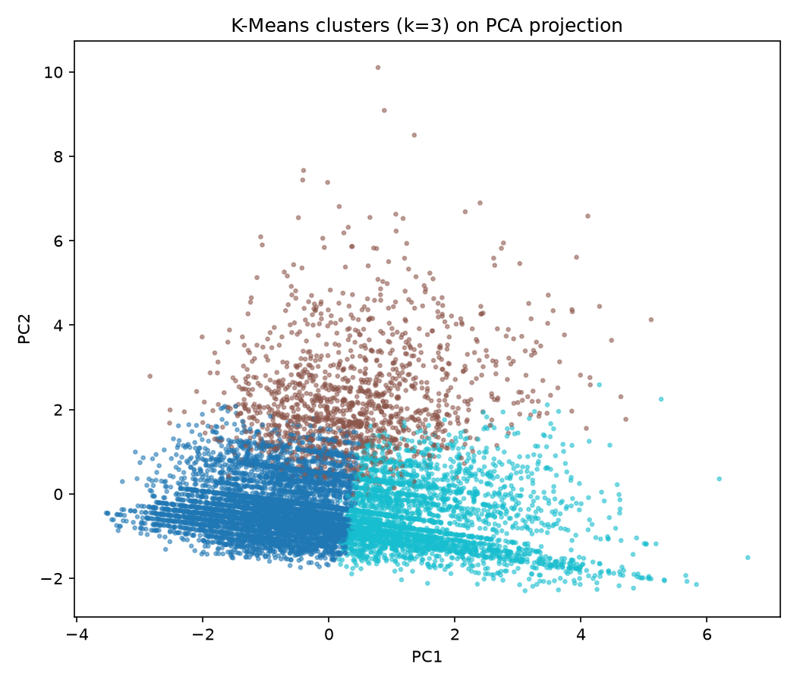
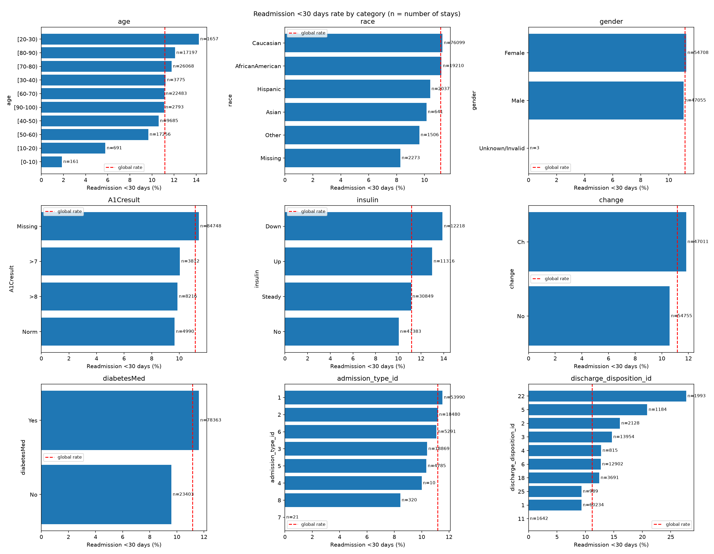
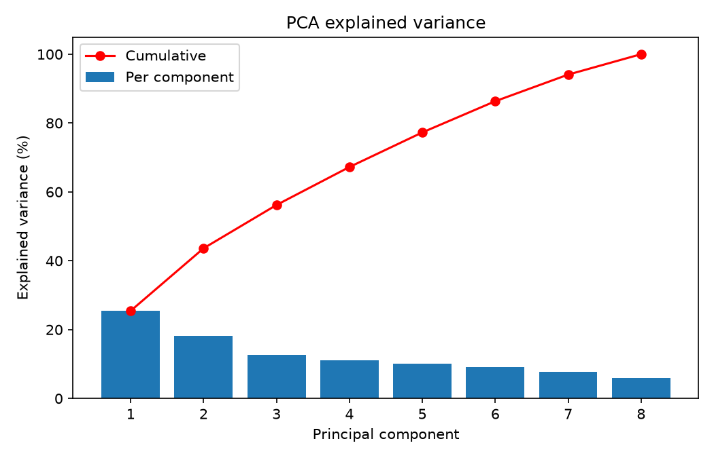
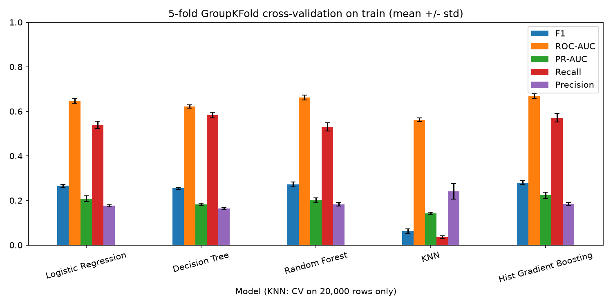
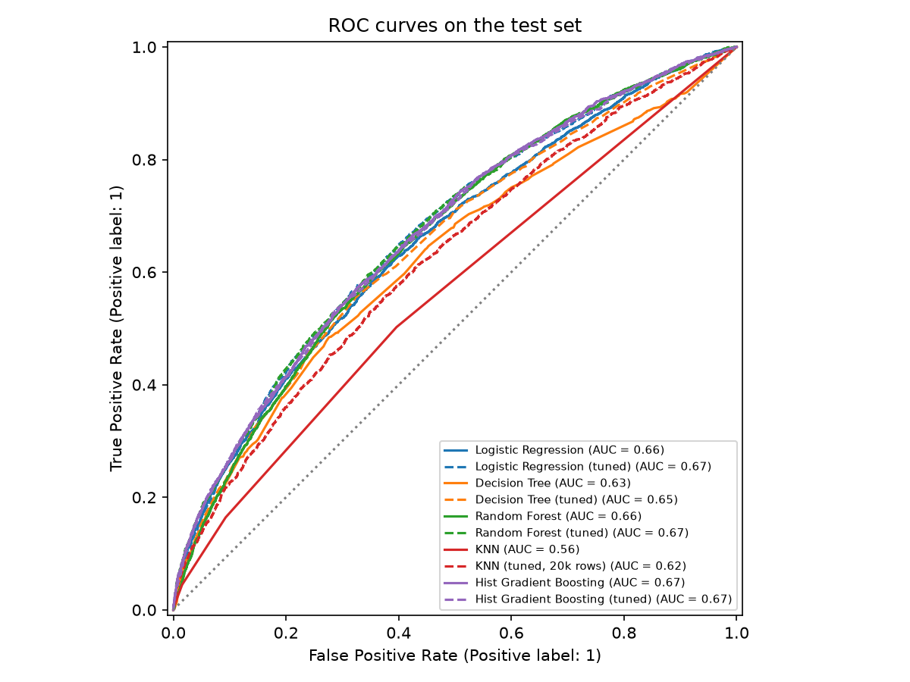
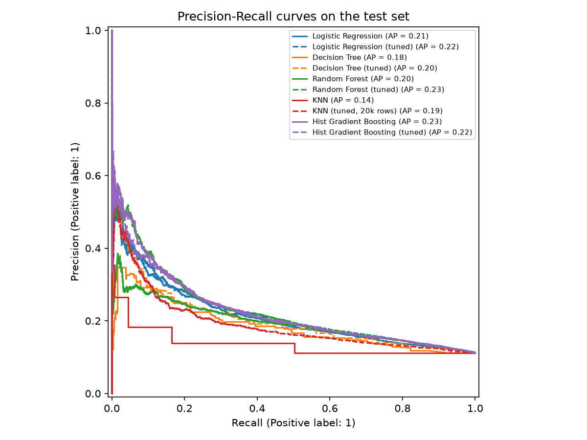
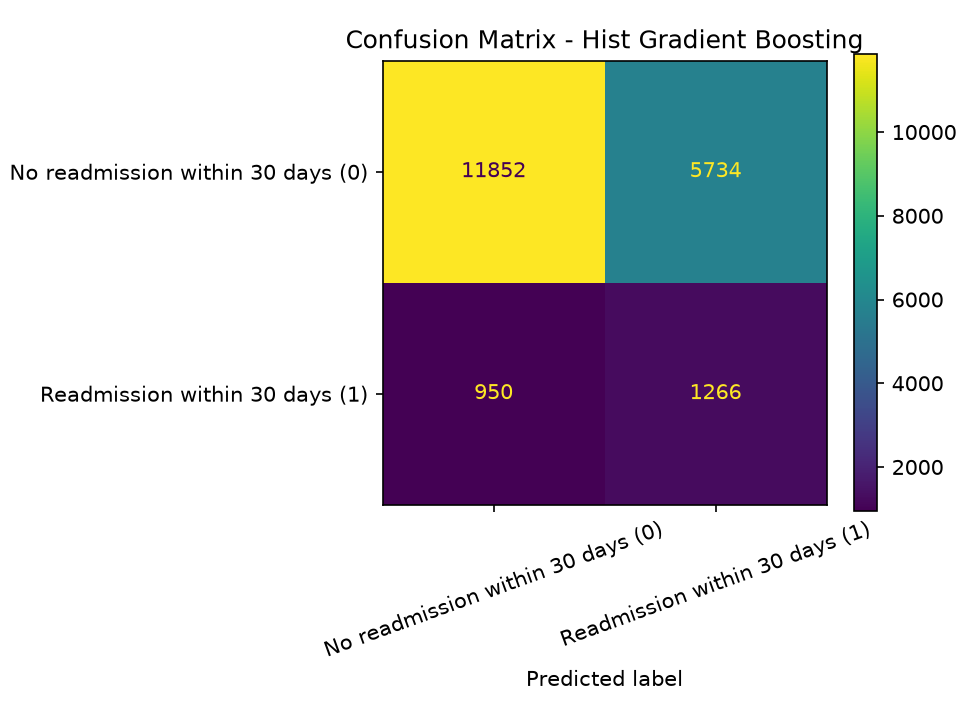
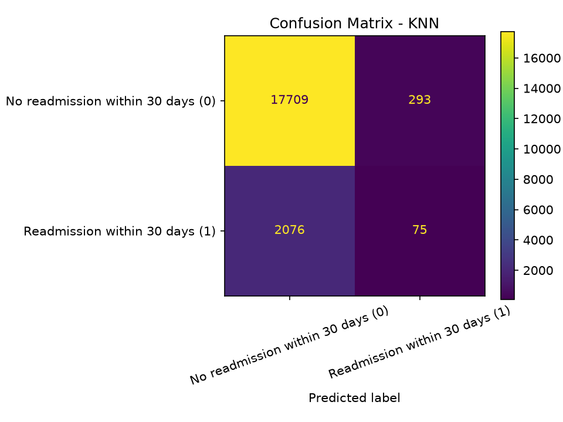
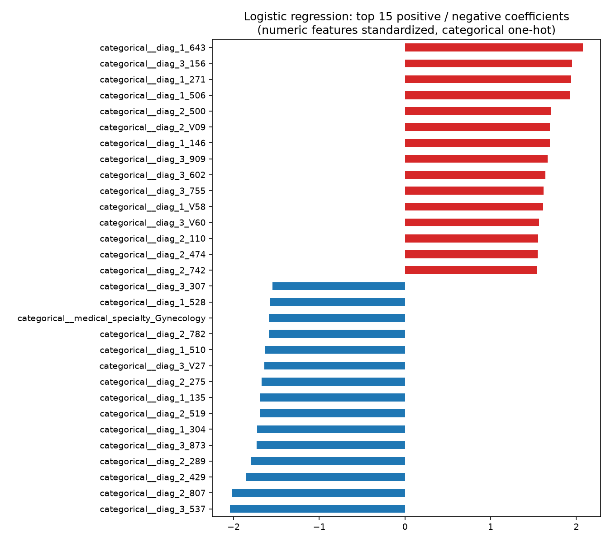

# Predicting 30-day readmission of diabetic patients

Course project: TI508M/TI608M, Introduction to Machine Learning. Authors: Olivia Baudet, Paolo, Garance.

Educational project: this is not a validated medical tool.

Contents: 1 Introduction · 2 Data · 3 Exploration · 4 Preprocessing · 5 Methods · 6 Evaluation protocol · 7 Results · 8 Discussion · 9 Limitations and ethics · 10 Recommendations · 11 Reproducibility · Appendix · Verification

---

## 1. Introduction and research question

**Context.** Early hospital readmissions are a quality-of-care issue. We use the public UCI dataset "Diabetes 130-US hospitals for years 1999-2008".

**Question.** Can the information available about a hospital stay of a diabetic patient predict a readmission within 30 days after discharge?

**Chosen formulation: supervised binary classification.** The target is 1 if `readmitted` = `<30`, and 0 if `>30` or `NO`. The positive class (1) is 30-day readmission.

**Why not clustering (K-Means + PCA)?** We tested it as an exploratory analysis (`code/06_pca_kmeans.py`, filtered population of 99,343 stays, train and test combined; K-Means with k=3 on 8 standardized numeric variables, `log1p` on 4 count variables followed by `StandardScaler`; PCA is used to measure variance and to visualize the clusters in 2D; silhouette computed on 10,000 stays). Results (`results/clustering_summary.txt`):

- The PCA is not very compact: the 1st component carries 25.5% of the variance, the first two 43.6%, and 5 components are needed to reach 77.3%.
- Silhouette (sample of 10,000 rows): 0.182 (k=2), 0.187 (k=3), 0.154 (k=4), 0.161 (k=5), 0.161 (k=6), 0.165 (k=7), 0.159 (k=8). The maximum, 0.187 (k=3), remains low (< 0.25 according to the script): the clusters are weakly separated.
- The clusters nevertheless differ in readmission rate: cluster 0: 0.092 (n = 56,019), cluster 1: 0.171 (n = 14,140), cluster 2: 0.128 (n = 29,184), for a global rate of 0.114. The max/min ratio is 1.85 (descriptive only, no confidence interval, stays not independent).

Clustering therefore contains a signal (cluster 1 combines many prior outpatient, emergency and inpatient visits), but it does not separate patients clearly. Since we have a reliable label, supervised learning is better suited to predict readmission. Clustering remains a descriptive tool.



*Figure 1 — The three clusters form contiguous regions, with no clear separation in the (PC1, PC2) plane; only the high-PC2 zone is somewhat more isolated.*

---

## 2. Data

- **Source**: UCI Machine Learning Repository, dataset 296 (file `diabetic_data.csv`, not versioned; `?` treated as a missing value).
- **Size**: 101,766 stays, 71,518 unique patients. 16,773 patients have more than one stay; 47,021 rows belong to a `patient_nbr` that appears more than once (`eda_summary.txt`). Stays are therefore not independent.
- **Prevalence on the full file**: 11,357 readmissions < 30 days, i.e. 0.1116 (11.16%). The target is imbalanced.
- **Missing values (% of the full file)**: `weight` 96.86; `max_glu_serum` 94.75; `A1Cresult` 83.28; `medical_specialty` 49.08; `payer_code` 39.56; `race` 2.23; `diag_3` 1.40; `diag_2` 0.35; `diag_1` 0.02.
- **Exclusion for classification**: 2,423 stays ending in death or transfer to hospice (`discharge_disposition_id` ∈ {11, 13, 14, 19, 20, 21}), for which readmission is impossible or not meaningful (`code/02_preprocessing.py`). 99,343 stays remain (101,766 − 2,423).
- **Split**: training 79,541 rows, test 19,802 rows. Readmission share: 0.114 (train, 9,098 positives) and 0.112 (test, 2,216 positives), computed from `y_train.csv` and `y_test.csv`.
- **Identifiers**: `encounter_id` and `patient_nbr` are not used as predictive features; `patient_nbr` is used only to group the stays of the same patient.

The 0.1139 rate in the clustering is computed on the filtered population (99,343 stays), the 0.1116 rate on the full file.

---

## 3. Exploratory data analysis (EDA)

The EDA (`code/01_explore_data.py`, `results/eda_summary.txt`) covers the full file.

**Correlations with the target (Pearson).** All are weak: `number_inpatient` 0.165 (highest), `number_emergency` 0.061, `number_diagnoses` 0.050, `time_in_hospital` 0.044, `num_medications` 0.038, `num_lab_procedures` 0.020, `number_outpatient` 0.019, `num_procedures` −0.012. The matrix also shows moderate correlations among predictors (for example `time_in_hospital` and `num_medications`: 0.47 in the figure). No numeric variable is strongly related to the target: modest performance is to be expected.


*Figure 2 — Correlation matrix of the numeric variables and the target; the "target" row is almost uniformly close to 0, except for `number_inpatient`.*

**30-day readmission rate by category** (`eda_summary.txt`):

| Variable | Notable categories (rate in %) |
|---|---|
| `insulin` | No 10.04; Steady 11.13; Up 12.99; Down 13.90 |
| `diabetesMed` | No 9.60; Yes 11.63 |
| `change` | No 10.59; Ch 11.82 |
| `discharge_disposition_id` | 1: 9.30; 3: 14.66; 2: 16.07; 5: 20.86; 22: 27.70 (11: 0.00, stays excluded afterwards) |
| `age` | [0-10) 1.86 (n = 161); [20-30) 14.24 (n = 1,657); [80-90) 12.08; [50-60) 9.67 |
| `race` | Missing 8.27; Caucasian 11.29; AfricanAmerican 11.22 |
| `gender` | Male 11.06; Female 11.25 |
| `A1Cresult` | Norm 9.66; >8 9.87; >7 10.05; Missing 11.42 |

The clearest differences concern the discharge disposition (`discharge_disposition_id`), insulin treatment and a few age groups. The young age groups ([0-10) n = 161, [10-20) n = 691, [20-30) n = 1,657) have small sample sizes: interpret with caution. Differences by gender or race are small.



*Figure 3 — 30-day readmission rate by category for the categorical variables.*

Other EDA figures are available: `eda_missing_values.png`, `eda_numeric_by_target.png`, `readmission_distribution.png`.

**PCA.** See section 1: on 8 numeric variables, the variance is spread over many components (25.5; 18.2; 12.6; 11.0; 10.0; 9.1; 7.7; 5.9%), which confirms that these variables carry fairly distinct information and that strong dimensionality reduction is not possible without loss.



*Figure 4 — Variance explained per component (numerical values in `clustering_summary.txt`).*

---

## 4. Preprocessing

Preprocessing is defined in `code/02_preprocessing.py` and `code/03_train_models.py`.

1. **Filtering** of the 2,423 death/hospice stays (section 2).
2. **Patient-grouped train/test split**: `GroupShuffleSplit` (test = 20%, `random_state=42`) with `patient_nbr` as the group. *Why:* a patient often has several very similar stays; if they were spread across train and test, the model could "recognize" the patient and the score would be inflated (data leakage).
3. **Numeric variables**: median imputation, then `StandardScaler`.
4. **Categorical variables** (including `admission_type_id`, `discharge_disposition_id`, `admission_source_id`, which are codes and not measurements): most-frequent-value imputation, then one-hot encoding (`handle_unknown="ignore"`).
5. **Everything is fitted on the training set only**, inside scikit-learn `Pipeline` objects, to avoid any leakage to the test set.
6. **Class imbalance**: `class_weight="balanced"` for logistic regression, the decision tree, the random forest and HistGradientBoosting. KNN does not support this option in scikit-learn.

The clusters (section 1) use a separate preprocessing (`log1p` + `StandardScaler` on 8 numeric variables).

---

## 5. Methods

The project explicitly encourages techniques not covered in class; we use them and explain them.

| Method | Covered in class? | Role in the project |
|---|---|---|
| `StandardScaler` | Yes | Scaling of numeric variables |
| KNN | Yes, for regression only | Used here for classification (not covered in class) |
| K-Means | Yes | Exploratory clustering (k=3) |
| PCA | Yes | Projection and explained variance (exploration) |
| Silhouette | Yes | Choice of k and cluster quality |
| Train / validation / test | Yes (concept) | Split; validation is done by CV on the training set |
| Cross-validation | Mentioned | Estimate the variability of scores (5 folds) |
| Logistic regression | No | Linear baseline model |
| Decision tree | No | Interpretable, non-linear model |
| Random forest | No | Ensemble of trees |
| HistGradientBoosting | No | Tree boosting |
| Confusion matrix, precision / recall / F1 | No | Classification metrics |
| ROC-AUC, PR-AUC | No | Threshold-independent metrics |
| `GroupKFold` | No | CV without sharing patients across folds |
| `RandomizedSearchCV` | No | Hyperparameter tuning |
| `class_weight` | No | Compensate for imbalance |
| Decision threshold | No | Precision / recall trade-off |
| One-hot, imputation | No | Feature preparation |

**Explanations of the notions not covered in class.**

- **Logistic regression**: linear model that estimates a readmission probability from a weighted combination of the features. The parameter `C` controls regularization (the smaller `C`, the more constrained the model).
- **Decision tree**: sequence of questions "feature > threshold?" that splits the data; its depth (`max_depth`) and minimum leaf size (`min_samples_leaf`) limit overfitting.
- **Random forest**: average of many trees trained on different samples and feature subsets; reduces the variance of a single tree.
- **HistGradientBoosting**: trees built one after another, each correcting the errors of the previous ones; features are binned into histograms to speed up computation.
- **KNN for classification**: predicts from the class of the k nearest neighbors; costly with about 2,400 columns (after one-hot encoding).
- **Confusion matrix**: table of true/false positives and negatives. **Precision** = share of alerts that are true cases; **recall** = share of true cases detected; **F1** = harmonic mean of the two.
- **ROC-AUC**: probability that a positive case receives a higher score than a negative case (0.5 = chance). **PR-AUC** (average precision): area under the precision-recall curve; more informative when the positive class is rare (a random prediction has a PR-AUC equal to the prevalence, about 0.11).
- **`GroupKFold`**: cross-validation where all stays of the same patient remain in the same fold.
- **`RandomizedSearchCV`**: tries a fixed number of hyperparameter combinations drawn from a grid and evaluates them by CV.
- **`class_weight="balanced"`**: gives more weight to errors on the rare class.
- **Decision threshold**: probability value above which 1 is predicted; 0.5 by default but adjustable.
- **One-hot**: one 0/1 column per category. **Imputation**: replacement of missing values by an estimated value (median or most frequent value).

**Models and baseline configuration** (`code/03_train_models.py`): logistic regression (`max_iter=1000`, C=1 by default), decision tree (`max_depth=12`), random forest (100 trees, `max_depth=18`), KNN (k=5), HistGradientBoosting (default parameters, `early_stopping=False`); `random_state=42`.

---

## 6. Evaluation protocol

1. **A single test split (20%, patient-grouped)**, never used to choose a model, a hyperparameter or a threshold.
2. **`GroupKFold` cross-validation with 5 folds on the training set of the baseline models (configuration of 03)**, grouped by `patient_nbr`: mean and standard deviation of F1, ROC-AUC, PR-AUC, recall and precision (`cv_results.csv`).
3. **Tuning** (`code/07_cv_tuning.py`): `RandomizedSearchCV`, `n_iter` = min(8, grid size) (at most 8 draws; full grid for logistic regression, 5 draws, and for KNN, 6), 5-fold `GroupKFold`, `average_precision` scoring (PR-AUC), on the training set only. The search runs on a stratified, patient-grouped subsample of the training set (26,514 rows, i.e. one third of the training set, for all models except KNN; for KNN, search on the 20,000 rows randomly drawn from the training set). The best model is then refitted on the whole training set (79,541 rows), except KNN (20,000 rows).
4. **Decision threshold**: for each tuned model, the threshold maximizing F1 on the out-of-fold predictions of the training set (`thresholds.json`), then evaluation on the test set at 0.5 and at the optimized threshold.
5. **Why accuracy is misleading.** On the test set, 2,216 rows out of 19,802 are positive: a model that always predicts 0 would obtain an accuracy of 0.888 (computed from `y_test.csv`, 1 − 0.112) without detecting any case. The tuned KNN at 0.5 has an accuracy of 0.888 but a recall of 0.009; the baseline KNN has 0.879 accuracy and 0.045 recall. We therefore favor ROC-AUC, PR-AUC, recall, precision and F1 of class 1.

---

## 7. Results

### 7.1 Baseline models on the test set (threshold 0.5) — `model_comparison.csv`

| Model | Accuracy | Precision (class 1) | Recall (class 1) | F1 (class 1) | Balanced acc. | ROC-AUC | PR-AUC |
|---|---|---|---|---|---|---|---|
| Hist Gradient Boosting | 0.662 | 0.181 | 0.571 | 0.275 | 0.623 | 0.670 | 0.227 |
| Random Forest | 0.668 | 0.180 | 0.552 | 0.271 | 0.617 | 0.662 | 0.197 |
| Logistic Regression | 0.659 | 0.175 | 0.554 | 0.266 | 0.613 | 0.656 | 0.213 |
| Decision Tree | 0.592 | 0.155 | 0.596 | 0.246 | 0.594 | 0.625 | 0.185 |
| KNN (k=5) | 0.879 | 0.265 | 0.045 | 0.076 | 0.515 | 0.563 | 0.137 |

### 7.2 5-fold grouped cross-validation on the training set (baseline models) — `cv_results.csv`

| Model | Train rows | F1 | ROC-AUC | PR-AUC | Recall | Precision |
|---|---|---|---|---|---|---|
| Logistic Regression | 79,541 | 0.266 ± 0.007 | 0.647 ± 0.010 | 0.208 ± 0.013 | 0.540 ± 0.016 | 0.176 ± 0.005 |
| Decision Tree | 79,541 | 0.255 ± 0.005 | 0.622 ± 0.007 | 0.182 ± 0.006 | 0.583 ± 0.013 | 0.163 ± 0.005 |
| Random Forest | 79,541 | 0.272 ± 0.011 | 0.662 ± 0.011 | 0.200 ± 0.012 | 0.530 ± 0.018 | 0.183 ± 0.008 |
| KNN | 20,000 | 0.063 ± 0.010 | 0.562 ± 0.008 | 0.143 ± 0.005 | 0.036 ± 0.006 | 0.241 ± 0.035 |
| Hist Gradient Boosting | 79,541 | 0.279 ± 0.009 | 0.669 ± 0.010 | 0.224 ± 0.014 | 0.571 ± 0.020 | 0.185 ± 0.006 |

(Mean ± standard deviation over the 5 folds.)



*Figure 5 — Means and standard deviations in CV. The error bars of HGB, RF and LR overlap on most metrics, except ROC-AUC between LR and HGB and recall between RF and HGB; KNN (20,000 rows) is clearly behind on F1, ROC-AUC, PR-AUC and recall.*

### 7.3 Tuned models on the test set — `tuned_comparison.csv`

Selected hyperparameters (`best_params.json`, search score = PR-AUC on the subsample):

| Model | Hyperparameters | Search PR-AUC |
|---|---|---|
| Logistic Regression | C=0.01 | 0.201 |
| Decision Tree | max_depth=8, min_samples_leaf=200 | 0.190 |
| Random Forest | n_estimators=200, max_depth=18, min_samples_leaf=5, max_features=0.1 | 0.201 |
| KNN | n_neighbors=101, weights=distance | 0.204 |
| Hist Gradient Boosting | learning_rate=0.05, max_iter=100, max_leaf_nodes=15, l2_regularization=10.0 | 0.212 |

Optimized thresholds (`thresholds.json`): LR 0.521; DT 0.549; RF 0.516; KNN 0.117; HGB 0.535.

| Model | Train rows | Threshold | Value | Accuracy | Precision | Recall | F1 | Balanced acc. | ROC-AUC | PR-AUC |
|---|---|---|---|---|---|---|---|---|---|---|
| Logistic Regression | 79,541 | 0.5 | 0.500 | 0.672 | 0.183 | 0.559 | 0.276 | 0.623 | 0.670 | 0.217 |
| Logistic Regression | 79,541 | optimized | 0.521 | 0.708 | 0.192 | 0.503 | 0.278 | 0.618 | 0.670 | 0.217 |
| Decision Tree | 79,541 | 0.5 | 0.500 | 0.619 | 0.166 | 0.597 | 0.260 | 0.610 | 0.650 | 0.203 |
| Decision Tree | 79,541 | optimized | 0.549 | 0.736 | 0.193 | 0.426 | 0.265 | 0.601 | 0.650 | 0.203 |
| Random Forest | 79,541 | 0.5 | 0.500 | 0.690 | 0.187 | 0.530 | 0.277 | 0.620 | 0.671 | 0.226 |
| Random Forest | 79,541 | optimized | 0.516 | 0.726 | 0.200 | 0.482 | 0.283 | 0.620 | 0.671 | 0.226 |
| KNN | 20,000 | 0.5 | 0.500 | 0.888 | 0.525 | 0.009 | 0.019 | 0.504 | 0.624 | 0.190 |
| KNN | 20,000 | optimized | 0.117 | 0.630 | 0.159 | 0.535 | 0.245 | 0.589 | 0.624 | 0.190 |
| Hist Gradient Boosting | 79,541 | 0.5 | 0.500 | 0.641 | 0.174 | 0.587 | 0.268 | 0.617 | 0.668 | 0.223 |
| Hist Gradient Boosting | 79,541 | optimized | 0.535 | 0.717 | 0.194 | 0.484 | 0.277 | 0.615 | 0.668 | 0.223 |
| KNN (base, k=5) | 79,541 | 0.5 | 0.500 | 0.879 | 0.265 | 0.045 | 0.076 | 0.515 | 0.563 | 0.137 |

ROC-AUC and PR-AUC do not depend on the threshold: they are identical for the two rows of the same model.

### 7.4 ROC and precision-recall curves (test set)



*Figure 6 — ROC curves on the test set. The baseline and tuned (dashed) models of LR, RF and HGB are almost superimposed, clearly above the diagonal but far from the ideal curve. The tree and KNN are below; the baseline KNN curve is angular (few distinct score values).*



*Figure 7 — Precision-recall curves on the test set. Precision falls back toward the prevalence (about 0.11) as recall increases; it exceeds 0.4 only at very low recall. The baseline KNN curve is staircase-shaped.*

### 7.5 Confusion matrices

The confusion matrices are in `results/figures/*_confusion_matrix.png` (baseline models, threshold 0.5) and `*_tuned_confusion_matrix.png` (tuned models, optimized threshold). The two below (baseline models, threshold 0.5) illustrate the extreme cases.



*Figure 8 — HistGradientBoosting (baseline): a compromise between false positives and false negatives (recall 0.571, precision 0.181).*



*Figure 9 — Baseline KNN: almost all stays are classified "no readmission" (recall 0.045).*

### 7.6 Feature importance


*Figure 10 — Baseline random forest, 15 most important features (impurity-based importance). `number_inpatient` dominates (about 0.13), far ahead of `discharge_disposition_id_1` (about 0.04), `num_medications`, `time_in_hospital` and `number_emergency` (about 0.027 to 0.033). Values read from the chart, not saved in a file.*



*Figure 11 — Logistic regression, extreme coefficients: the chart is dominated by rare diagnosis codes (`diag_1_643`, `diag_3_537`, etc.) with coefficients of about ±1.5 to ±2.1. These categories are very rare in the training set (3 to 6 stays for the largest positive coefficients, for example `diag_1_643`: 4; 26 to 48 for the negative ones shown): these coefficients are unstable (baseline logistic regression, C=1; they are not those of the tuned model, C=0.01, which is more strongly regularized) and must not be read as risk factors.*

---

## 8. Comparison and discussion

**Model ranking.** By test PR-AUC (baseline): HGB 0.227 > LR 0.213 > RF 0.197 > DT 0.185 > KNN 0.137. By test ROC-AUC (baseline): HGB 0.670 > RF 0.662 > LR 0.656 > DT 0.625 > KNN 0.563. By test F1 (baseline): HGB 0.275 > RF 0.271 > LR 0.266 > DT 0.246 > KNN 0.076. In CV, HGB is also first on F1 (0.279), ROC-AUC (0.669) and PR-AUC (0.224).

**Statistical caution.** The differences between HGB and RF are smaller than the CV standard deviation (ROC-AUC 0.669 ± 0.010 versus 0.662 ± 0.011). HGB is ahead of baseline LR by about two standard deviations in CV ROC-AUC (0.669 versus 0.647), but on the test set, once both are tuned, the gap disappears (tuned logistic regression 0.670 versus tuned HGB 0.668). The standard deviation across folds is not a statistical test. The ranking among these three models is therefore not demonstrated, and the ranking of the tuned models changes with the metric (tuned RF has the best PR-AUC and the best F1 at the optimized threshold; tuned LR and tuned HGB are very close). The test set is a single split, without a confidence interval. We do not name a clear winner. What the results support: these three models form a group of about 0.66-0.67 ROC-AUC, ahead of the decision tree (0.625 baseline, 0.650 tuned) and KNN.

**Effect of tuning.** It is modest and uneven. Baseline to tuned (test): ROC-AUC LR 0.656 → 0.670, RF 0.662 → 0.671, DT 0.625 → 0.650, HGB 0.670 → 0.668; PR-AUC RF 0.197 → 0.226, HGB 0.227 → 0.223. For HGB, tuning does no better than the baseline configuration. The ROC-AUC gains of LR, RF and HGB (≤ 0.014) are of the same order as the CV variability; those of the tree (+0.025 in ROC-AUC) and of RF in PR-AUC (≈ +0.03) are clearer but are still measured on a single test set; with a reduced grid and a subsample, this is not a thorough optimization.

**Effect of the threshold.** For LR, DT, RF and HGB, moving from 0.5 to the optimized threshold lowers recall (LR 0.559 → 0.503, RF 0.530 → 0.482, HGB 0.587 → 0.484, DT 0.597 → 0.426) and raises precision (LR 0.183 → 0.192, RF 0.187 → 0.200, HGB 0.174 → 0.194, DT 0.166 → 0.193), with F1 almost unchanged (gain of 0.002 to 0.009 for LR, DT, RF and HGB). The threshold therefore does not change how well patients are ranked (identical AUC) but moves the operating point. Choosing the threshold amounts to choosing how many alerts one agrees to handle.

**KNN.** The baseline KNN (k=5) almost always predicts 0 (recall 0.045). The tuned KNN at 0.5 is even worse (recall 0.009, precision 0.525): only 40 probabilities out of 19,802 exceed 0.5 on the test set (mean 0.109, `knn_tuned_predictions.csv`), i.e. 21 true positives out of 40 alerts. Its optimized threshold is very low (0.117) and it then reaches a recall of 0.535 and an F1 of 0.245. The comparison is not fair: the tuned KNN is trained on only 20,000 randomly drawn rows (versus 79,541), and the KNN row of `cv_results.csv` corresponds to the baseline KNN (k=5) on those same 20,000 rows. Its lower score therefore does not prove that the method is less suitable with equal data.

**Decision tree.** It is the worst of the four non-KNN models at baseline (ROC-AUC 0.625, PR-AUC 0.185, F1 0.246) and in CV (ROC-AUC 0.622 ± 0.007). Tuned, it improves (ROC-AUC 0.650) but stays below the other three (0.668 to 0.671).

**Important features.** `number_inpatient` (number of prior inpatient stays) is the most important feature for the forest and the most correlated with the target (0.165), which is consistent with the EDA. The results allow no causal conclusion.

**Performance level.** The scores are modest: ROC-AUC ≈ 0.67 and F1 ≈ 0.28. At one of the best settings, precision is about 0.2: about 4 alerts out of 5 are false alarms. The model ranks better than chance (ROC-AUC 0.5; reference PR-AUC ≈ 0.11) but is not precise enough to decide alone.

---

## 9. Limitations and ethics

- **Modest scores** (ROC-AUC ≈ 0.67): the available features are weakly informative (Pearson correlations of the numeric variables with the target ≤ 0.165).
- **A single test split**: no confidence interval on the test scores; small differences between models are not significant.
- **Limited tuning**: subsample of about 26,500 rows (one third of the training set), small grids, at most 8 draws (logistic regression 5, KNN 6).
- **KNN on 20,000 rows**: comparison with the other models is not fair.
- **Threshold chosen on models trained on 4/5 of the training set**: the out-of-fold predictions come from models trained on 4 folds out of 5, whereas the final model is trained on the whole training set; the optimal threshold may be slightly shifted.
- **Repeated stays**: CV is grouped by patient, but the stays of a patient remain correlated and the test set remains a single draw of patients.
- **Data from 1999 to 2008**, US hospitals: practices, coding and populations have changed; not representative of today or of other countries.
- **Impurity-based importance (RF) is biased** in favor of numeric variables or variables with many values; the logistic regression coefficients on rare categories are unstable (Figure 11).
- **Exploratory clustering**: low silhouette (0.187); readmission rates per cluster are descriptive, without confidence interval, with non-independent stays.
- **Features available at prediction time**: some information, notably `discharge_disposition_id` (discharge disposition, strongly related to the readmission rate) or the number of diagnoses, is known only at discharge. The model is only suitable for a prediction made at discharge time; we did not analyze each variable, which the project README asks us to discuss.
- **Exclusion of deaths and hospice discharges** (2,423 stays): the test population does not contain these patients; a real-world use would have to handle them separately.
- **Missing values**: simple imputation (median / most frequent value); several variables are almost empty (`weight`, `max_glu_serum`, `A1Cresult`).
- **No calibration** of the probabilities: the scores are not reliable probabilities (with class_weight="balanced", the mean predicted probability on the test set is about 0.42 to 0.47 depending on the model (baseline: tree 0.420, HGB 0.446, LR 0.448, forest 0.469; tuned: forest 0.438, tree 0.461, LR 0.463, HGB 0.463) for a prevalence of 0.11; a low optimal threshold, such as 0.117 for KNN, is not enough to demonstrate poor calibration).
- **No fairness analysis** by subgroup (race, age, gender): we did not measure whether performance differs across these groups.
- **Ethics**: a model of this kind could steer follow-up resources; without validation, governance and expert review, it must not be used for real clinical decisions.

---

## 10. Recommendations and ideas for improvement

**Use.** At best a screening tool that helps prioritize follow-up, not an automatic decision. The threshold should be chosen according to follow-up capacity: a low threshold detects more readmissions (higher recall) but generates more false alarms, and conversely (section 8).

**Practical priority.** Patients with a history of hospitalization (`number_inpatient`) are those for whom the signal is clearest in our results. This observation is associative, not causal.

**Ideas for improvement (not tested in this project):**

- Feature engineering: comorbidities, grouping of ICD-9 diagnosis codes into broad families (the current roughly 2,400 columns, of which about 2,180 come from the three diagnosis columns, contain many rare codes), patient history.
- Wider tuning grids, on the whole training set.
- Probability calibration.
- Resampling (for example SMOTE) to compare with `class_weight`.
- Other boosting libraries (XGBoost, LightGBM).
- Fairness analysis by subgroup.
- Validation on more recent data and on several splits (repeated or nested) to obtain confidence intervals.

---

## 11. Reproducibility

**Execution order** (from the project root):

```text
python code/01_explore_data.py
python code/02_preprocessing.py
python code/03_train_models.py
python code/04_evaluation.py
python code/05_visualize_results.py
python code/06_pca_kmeans.py
python code/07_cv_tuning.py
```

Rerun `04` and `05` after `07` to include the tuned models in the confusion matrices, the ROC/PR curves and the CV figure (README).

**Versions** (README): Python 3.14, pandas 3.1.1, numpy 2.5.5, matplotlib 3.11.2, scikit-learn 1.9.1 (scikit-learn >= 1.9 is required for `PrecisionRecallDisplay.from_predictions(curve_kwargs=...)`).

**Computation time** (measured, according to the README): `07_cv_tuning.py` took about 10 minutes on a 22-core machine, cross-validation included. The run time of the other scripts is not recorded.

**Resuming**: each result of `07` is saved in `results/predictions/_state/` with a sha256 fingerprint of the code and of the labels; `python code/07_cv_tuning.py --force` recomputes all results of `07` (to be done after a change to `02`, because the fingerprint does not cover the feature tables).

**Random seed**: `random_state=42` for the split, the models and the search.

**Files produced**: see the appendix.

---

## Appendix — Files in `results/`

| File | Content |
|---|---|
| `model_comparison.csv` | Test metrics of the 5 baseline models |
| `cv_results.csv` | Mean and standard deviation of the 5-fold grouped CV |
| `tuned_comparison.csv` | Test metrics of the tuned models (threshold 0.5 and optimized) + baseline KNN |
| `best_params.json` | Best hyperparameters and search score |
| `thresholds.json` | Optimized thresholds (out-of-fold F1 on the training set) |
| `eda_summary.txt` | EDA summary (full file) |
| `clustering_summary.txt`, `clustering_summary.csv` | PCA / K-Means summary and cluster profiles |
| `X_train.csv`, `X_test.csv`, `y_train.csv`, `y_test.csv`, `train_groups.csv` | Data resulting from the split |
| `predictions/` | Test predictions per model (y_true, y_pred, y_proba); `_state/` for resuming |
| `figures/` | Charts: `eda_*.png`, `readmission_distribution.png`, `pca_*.png`, `kmeans_*.png`, `*_confusion_matrix.png`, `*_tuned_confusion_matrix.png`, `roc_curves_test.png`, `pr_curves_test.png`, `cv_comparison.png`, `comparison_*.png`, `feature_importance_*.png` |

---

## Conclusion and references

On 99,343 stays, the models distinguish 30-day readmissions somewhat better than chance (ROC-AUC ≈ 0.67 for HGB, RF and LR, whose differences are comparable to the CV variability), but with a precision of about 0.2 for a recall of about 0.5. The decision tree lags behind, and KNN, trained on less data, is not comparable. The results justify at most a screening use, with the limitations of section 9.

**References.**

- Strack, B. et al. (2014). *Impact of HbA1c Measurement on Hospital Readmission Rates: Analysis of 70,000 Clinical Database Patient Records.* BioMed Research International. UCI dataset: https://archive.ics.uci.edu/dataset/296/diabetes+130+us+hospitals+for+years+1999-2008
- scikit-learn documentation (version 1.9.1).

---

## Verification

Provenance of the figures:

| Figures | Source file |
|---|---|
| Sizes, 11.16% prevalence, missing values, correlations, rates by category, patients | `results/eda_summary.txt` |
| 2,423 excluded, 99,343 kept, versions, computation time, 26,500 rows, 20,000 KNN rows | `README.md`, `code/02_preprocessing.py` |
| Train/test sizes (79,541 / 19,802), positives (9,098 / 2,216), "always 0" accuracy = 0.888 | `results/y_train.csv`, `results/y_test.csv` (counts) |
| Search rows (26,514; 20,000 for KNN) | `results/best_params.json` (`search_rows`) |
| Tuned KNN: 40 probabilities > 0.5, 21 true positives, mean 0.109; mean probabilities 0.42 to 0.47 (calibration) | `results/predictions/*_predictions.csv` |
| PCA, silhouette, clusters, ratio 1.85 | `results/clustering_summary.txt`, `results/clustering_summary.csv` |
| Baseline test metrics | `results/model_comparison.csv` |
| CV | `results/cv_results.csv` |
| Tuned models, thresholds, baseline KNN | `results/tuned_comparison.csv`, `results/best_params.json`, `results/thresholds.json` |
| Protocol (n_iter = min(8, grid), 5 folds, grids, `max_depth=12`, etc.) | `code/02_preprocessing.py`, `code/03_train_models.py`, `code/07_cv_tuning.py` |
| Approximate importances (RF) and description of the figures | Visual reading of the PNG files in `results/figures/` |
