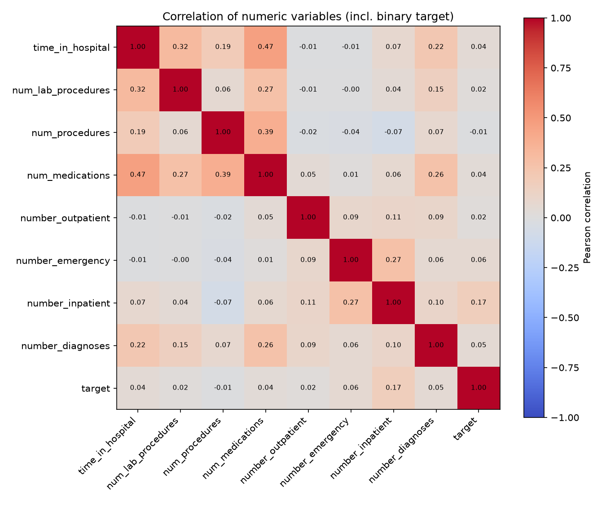
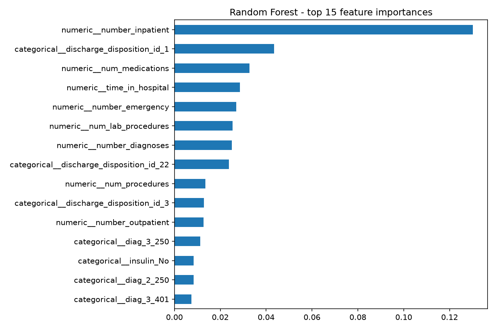

# Prédiction de la réadmission à 30 jours de patients diabétiques

Projet du cours Machine Learning - Paolo, Granace et Olivia

Projet à but pédagogique : ce n'est pas un outil médical validé.

Table des matières : 1 Introduction · 2 Données · 3 Exploration · 4 Prétraitement · 5 Méthodes · 6 Protocole d'évaluation · 7 Résultats · 8 Discussion · 9 Limites et éthique · 10 Recommandations · 11 Reproductibilité · Annexe · Vérifications

---

## 1. Introduction et question de recherche

**Contexte.** Les réadmissions hospitalières rapprochées sont un enjeu de qualité des soins. Nous utilisons le jeu public UCI « Diabetes 130-US hospitals for years 1999-2008 ».

**Question.** Les informations disponibles sur un séjour hospitalier d'un patient diabétique permettent-elles de prédire une réadmission dans les 30 jours suivant la sortie ?

**Formulation retenue : classification binaire supervisée.** La cible vaut 1 si `readmitted` = `<30`, et 0 si `>30` ou `NO`. La classe positive (1) est la réadmission à moins de 30 jours.

**Pourquoi pas du clustering (K-Means + PCA) ?** Nous l'avons testé en analyse exploratoire (`code/06_pca_kmeans.py`, population filtrée de 99 343 séjours, train et test confondus ; K-Means k=3 sur 8 variables numériques standardisées, `log1p` sur 4 variables de comptage puis `StandardScaler` ; la PCA sert à mesurer la variance et à visualiser les clusters en 2D ; silhouette calculée sur 10 000 séjours). Résultats (`results/clustering_summary.txt`) :

- La PCA n'est pas très compacte : la 1re composante porte 25,5 % de la variance, les deux premières 43,6 %, et il faut 5 composantes pour 77,3 %.
- Silhouette (échantillon de 10 000 lignes) : 0,182 (k=2), 0,187 (k=3), 0,154 (k=4), 0,161 (k=5), 0,161 (k=6), 0,165 (k=7), 0,159 (k=8). Le maximum, 0,187 (k=3), reste faible (< 0,25 selon le script) : les clusters sont faiblement séparés.
- Les clusters diffèrent pourtant par leur taux de réadmission : cluster 0 : 0,092 (n=56 019), cluster 1 : 0,171 (n=14 140), cluster 2 : 0,128 (n=29 184), pour un taux global de 0,114. Le rapport max/min vaut 1,85 (descriptif, sans intervalle de confiance, séjours non indépendants).

Le clustering contient donc un signal (le cluster 1 combine beaucoup de visites antérieures, en urgence, en consultation externe et en hospitalisation), mais il ne sépare pas nettement les patients. Comme nous disposons d'une étiquette fiable, un apprentissage supervisé est plus adapté pour prédire la réadmission. Le clustering reste un outil de description.


*Figure 1 — Les trois clusters forment des régions contiguës, sans séparation nette dans le plan (PC1, PC2) ; seule la zone de PC2 élevé est un peu plus isolée.*

---

## 2. Données

- **Source** : UCI Machine Learning Repository, dataset 296 (fichier `diabetic_data.csv`, non versionné ; `?` traité comme valeur manquante).
- **Taille** : 101 766 séjours, 71 518 patients uniques. 16 773 patients ont plus d'un séjour ; 47 021 lignes appartiennent à un `patient_nbr` qui apparaît plus d'une fois (`eda_summary.txt`). Les séjours ne sont donc pas indépendants.
- **Prévalence sur le fichier complet** : 11 357 réadmissions < 30 jours, soit 0,1116 (11,16 %). La cible est déséquilibrée.
- **Valeurs manquantes (% du fichier complet)** : `weight` 96,86 ; `max_glu_serum` 94,75 ; `A1Cresult` 83,28 ; `medical_specialty` 49,08 ; `payer_code` 39,56 ; `race` 2,23 ; `diag_3` 1,40 ; `diag_2` 0,35 ; `diag_1` 0,02.
- **Exclusion pour la classification** : 2 423 séjours terminés par un décès ou un transfert en hospice (`discharge_disposition_id` ∈ {11, 13, 14, 19, 20, 21}), pour lesquels une réadmission est impossible ou non pertinente (`code/02_preprocessing.py`). Il reste 99 343 séjours (101 766 − 2 423).
- **Découpage** : entraînement 79 541 lignes, test 19 802 lignes. Part de réadmissions : 0,114 (train, 9 098 positifs) et 0,112 (test, 2 216 positifs), calculées à partir de `y_train.csv` et `y_test.csv`.
- **Identifiants** : `encounter_id` et `patient_nbr` ne sont pas utilisés comme variables explicatives ; `patient_nbr` sert uniquement à regrouper les séjours d'un même patient.

Le taux de 0,1139 du clustering est calculé sur la population filtrée (99 343 séjours), celui de 0,1116 sur le fichier complet.

---

## 3. Analyse exploratoire (EDA)

L'EDA (`code/01_explore_data.py`, `results/eda_summary.txt`) porte sur le fichier complet.

**Corrélations avec la cible (Pearson).** Elles sont toutes faibles : `number_inpatient` 0,165 (en tête), `number_emergency` 0,061, `number_diagnoses` 0,050, `time_in_hospital` 0,044, `num_medications` 0,038, `num_lab_procedures` 0,020, `number_outpatient` 0,019, `num_procedures` −0,012. La matrice montre aussi des corrélations modérées entre variables explicatives (par exemple `time_in_hospital` et `num_medications` : 0,47 sur la figure). Aucune variable numérique n'est fortement liée à la cible : on s'attend à des performances modestes.



*Figure 2 — Matrice de corrélation des variables numériques et de la cible ; la ligne « target » est presque uniformément proche de 0, sauf `number_inpatient`.*

**Taux de réadmission < 30 j par modalité** (`eda_summary.txt`) :

| Variable | Modalités notables (taux en %) |
|---|---|
| `insulin` | No 10,04 ; Steady 11,13 ; Up 12,99 ; Down 13,90 |
| `diabetesMed` | No 9,60 ; Yes 11,63 |
| `change` | No 10,59 ; Ch 11,82 |
| `discharge_disposition_id` | 1 : 9,30 ; 3 : 14,66 ; 2 : 16,07 ; 5 : 20,86 ; 22 : 27,70 (11 : 0,00, séjours exclus ensuite) |
| `age` | [0-10) 1,86 (n=161) ; [20-30) 14,24 (n=1 657) ; [80-90) 12,08 ; [50-60) 9,67 |
| `race` | Missing 8,27 ; Caucasian 11,29 ; AfricanAmerican 11,22 |
| `gender` | Male 11,06 ; Female 11,25 |
| `A1Cresult` | Norm 9,66 ; >8 9,87 ; >7 10,05 ; Missing 11,42 |

Les écarts les plus nets concernent le mode de sortie (`discharge_disposition_id`), le traitement à l'insuline et quelques tranches d'âge. Les tranches d'âge jeunes ([0-10) n=161, [10-20) n=691, [20-30) n=1 657) ont de petits effectifs : à interpréter avec prudence. Les écarts selon le sexe ou la race sont faibles.


*Figure 3 — Taux de réadmission < 30 j par modalité pour les variables catégorielles.*

D'autres figures de l'EDA sont disponibles : `eda_missing_values.png`, `eda_numeric_by_target.png`, `readmission_distribution.png`.

**PCA.** Voir section 1 : sur 8 variables numériques, la variance est répartie sur de nombreuses composantes (25,5 ; 18,2 ; 12,6 ; 11,0 ; 10,0 ; 9,1 ; 7,7 ; 5,9 %), ce qui confirme que ces variables apportent des informations assez distinctes et qu'une réduction forte de dimension n'est pas possible sans perte.


*Figure 4 — Variance expliquée par composante (valeurs numériques dans `clustering_summary.txt`).*

---

## 4. Prétraitement

Le prétraitement est défini dans `code/02_preprocessing.py` et `code/03_train_models.py`.

1. **Filtrage** des 2 423 séjours décès/hospice (section 2).
2. **Découpage train/test groupé par patient** : `GroupShuffleSplit` (test = 20 %, `random_state=42`) avec `patient_nbr` comme groupe. *Pourquoi :* un patient a souvent plusieurs séjours très semblables ; s'ils étaient répartis entre train et test, le modèle pourrait « reconnaître » le patient et le score serait gonflé (fuite de données).
3. **Variables numériques** : imputation par la médiane, puis `StandardScaler`.
4. **Variables catégorielles** (y compris `admission_type_id`, `discharge_disposition_id`, `admission_source_id`, qui sont des codes et non des mesures) : imputation par la valeur la plus fréquente, puis encodage one-hot (`handle_unknown="ignore"`).
5. **Tout est ajusté sur le train uniquement**, dans des `Pipeline` scikit-learn, pour éviter toute fuite vers le test.
6. **Déséquilibre des classes** : `class_weight="balanced"` pour la régression logistique, l'arbre, la forêt et HistGradientBoosting. KNN ne supporte pas cette option dans scikit-learn.

Les clusters (section 1) utilisent un prétraitement distinct (`log1p` + `StandardScaler` sur 8 variables numériques).

---

## 5. Méthodes

Le projet encourage explicitement les techniques hors cours ; nous les utilisons et les expliquons.

| Méthode | Vue au cours ? | Rôle dans le projet |
|---|---|---|
| `StandardScaler` | Oui | Mise à l'échelle des variables numériques |
| KNN | Oui, en régression seulement | Utilisé ici en classification (hors cours) |
| K-Means | Oui | Clustering exploratoire (k=3) |
| PCA | Oui | Projection et variance expliquée (exploration) |
| Silhouette | Oui | Choix de k et qualité des clusters |
| Train / validation / test | Oui (notion) | Découpage ; la validation est faite par CV sur le train |
| Validation croisée | Mentionnée | Estimer la variabilité des scores (5 plis) |
| Régression logistique | Non | Modèle linéaire de référence |
| Arbre de décision | Non | Modèle interprétable, non linéaire |
| Forêt aléatoire | Non | Ensemble d'arbres |
| HistGradientBoosting | Non | Boosting d'arbres |
| Matrice de confusion, précision / rappel / F1 | Non | Métriques de classification |
| ROC-AUC, PR-AUC | Non | Métriques indépendantes du seuil |
| `GroupKFold` | Non | CV sans partage de patient entre plis |
| `RandomizedSearchCV` | Non | Réglage des hyperparamètres |
| `class_weight` | Non | Compenser le déséquilibre |
| Seuil de décision | Non | Compromis précision / rappel |
| One-hot, imputation | Non | Préparation des variables |

**Explications des notions hors cours.**

- **Régression logistique** : modèle linéaire qui estime une probabilité de réadmission à partir d'une combinaison pondérée des variables. Le paramètre `C` règle la régularisation (plus `C` est petit, plus le modèle est contraint).
- **Arbre de décision** : suite de questions « variable > seuil ? » qui découpe les données ; sa profondeur (`max_depth`) et la taille minimale des feuilles (`min_samples_leaf`) limitent le sur-apprentissage.
- **Forêt aléatoire** : moyenne de nombreux arbres entraînés sur des échantillons et des sous-ensembles de variables différents ; réduit la variance d'un arbre unique.
- **HistGradientBoosting** : arbres construits successivement, chacun corrigeant les erreurs des précédents ; les variables sont discrétisées en histogrammes pour accélérer le calcul.
- **KNN en classification** : prédit à partir de la classe des k plus proches voisins ; coûteux sur environ 2 400 colonnes (après one-hot).
- **Matrice de confusion** : table des vrais/faux positifs et négatifs. **Précision** = part des alertes qui sont de vrais cas ; **rappel** = part des vrais cas détectés ; **F1** = moyenne harmonique des deux.
- **ROC-AUC** : probabilité qu'un cas positif reçoive un score supérieur à un cas négatif (0,5 = hasard). **PR-AUC** (précision moyenne) : aire sous la courbe précision-rappel ; plus informative quand la classe positive est rare (une prédiction aléatoire a pour PR-AUC la prévalence, environ 0,11).
- **`GroupKFold`** : validation croisée où tous les séjours d'un même patient restent dans le même pli.
- **`RandomizedSearchCV`** : teste un nombre fixé de combinaisons d'hyperparamètres tirées dans une grille et les évalue par CV.
- **`class_weight="balanced"`** : pondère davantage les erreurs sur la classe rare.
- **Seuil de décision** : valeur de probabilité au-dessus de laquelle on prédit 1 ; 0,5 par défaut mais modifiable.
- **One-hot** : une colonne 0/1 par modalité. **Imputation** : remplacement des valeurs manquantes par une valeur estimée (médiane ou valeur la plus fréquente).

**Modèles et configuration de base** (`code/03_train_models.py`) : régression logistique (`max_iter=1000`, C=1 par défaut), arbre (`max_depth=12`), forêt (100 arbres, `max_depth=18`), KNN (k=5), HistGradientBoosting (paramètres par défaut, `early_stopping=False`) ; `random_state=42`.

---

## 6. Protocole d'évaluation

1. **Un seul découpage test (20 %, groupé par patient)**, jamais utilisé pour choisir un modèle, un hyperparamètre ou un seuil.
2. **Validation croisée `GroupKFold` à 5 plis sur le train des modèles de base (configuration de 03)**, groupée par `patient_nbr` : moyenne et écart-type de F1, ROC-AUC, PR-AUC, rappel et précision (`cv_results.csv`).
3. **Réglage** (`code/07_cv_tuning.py`) : `RandomizedSearchCV`, `n_iter` = min(8, taille de la grille) (au plus 8 tirages ; grille complète pour la régression logistique, 5 tirages, et le KNN, 6), `GroupKFold` à 5 plis, score `average_precision` (PR-AUC), sur le train uniquement. La recherche se fait sur un sous-échantillon stratifié et groupé du train (26 514 lignes, soit un tiers du train, pour tous les modèles sauf KNN ; pour KNN, recherche sur les 20 000 lignes tirées au hasard dans le train). Le meilleur modèle est ensuite réentraîné sur tout le train (79 541 lignes), sauf KNN (20 000 lignes).
4. **Seuil de décision** : pour chaque modèle réglé, seuil maximisant le F1 sur les prédictions hors-pli (out-of-fold) du train (`thresholds.json`), puis évaluation sur le test à 0,5 et au seuil optimisé.
5. **Pourquoi l'accuracy est trompeuse.** Sur le test, 2 216 lignes sur 19 802 sont positives : un modèle qui prédit toujours 0 obtiendrait une accuracy de 0,888 (calcul à partir de `y_test.csv`, 1 − 0,112), sans détecter aucun cas. Le KNN réglé à 0,5 a une accuracy de 0,888 mais un rappel de 0,009 ; le KNN de base, 0,879 d'accuracy et 0,045 de rappel. Nous privilégions donc ROC-AUC, PR-AUC, rappel, précision et F1 de la classe 1.

---

## 7. Résultats

### 7.1 Modèles de base sur le test (seuil 0,5) — `model_comparison.csv`

| Modèle | Accuracy | Précision (cl. 1) | Rappel (cl. 1) | F1 (cl. 1) | Acc. équilibrée | ROC-AUC | PR-AUC |
|---|---|---|---|---|---|---|---|
| Hist Gradient Boosting | 0.662 | 0.181 | 0.571 | 0.275 | 0.623 | 0.670 | 0.227 |
| Random Forest | 0.668 | 0.180 | 0.552 | 0.271 | 0.617 | 0.662 | 0.197 |
| Logistic Regression | 0.659 | 0.175 | 0.554 | 0.266 | 0.613 | 0.656 | 0.213 |
| Decision Tree | 0.592 | 0.155 | 0.596 | 0.246 | 0.594 | 0.625 | 0.185 |
| KNN (k=5) | 0.879 | 0.265 | 0.045 | 0.076 | 0.515 | 0.563 | 0.137 |

### 7.2 Validation croisée groupée à 5 plis sur le train (modèles de base) — `cv_results.csv`

| Modèle | Lignes train | F1 | ROC-AUC | PR-AUC | Rappel | Précision |
|---|---|---|---|---|---|---|
| Logistic Regression | 79 541 | 0.266 ± 0.007 | 0.647 ± 0.010 | 0.208 ± 0.013 | 0.540 ± 0.016 | 0.176 ± 0.005 |
| Decision Tree | 79 541 | 0.255 ± 0.005 | 0.622 ± 0.007 | 0.182 ± 0.006 | 0.583 ± 0.013 | 0.163 ± 0.005 |
| Random Forest | 79 541 | 0.272 ± 0.011 | 0.662 ± 0.011 | 0.200 ± 0.012 | 0.530 ± 0.018 | 0.183 ± 0.008 |
| KNN | 20 000 | 0.063 ± 0.010 | 0.562 ± 0.008 | 0.143 ± 0.005 | 0.036 ± 0.006 | 0.241 ± 0.035 |
| Hist Gradient Boosting | 79 541 | 0.279 ± 0.009 | 0.669 ± 0.010 | 0.224 ± 0.014 | 0.571 ± 0.020 | 0.185 ± 0.006 |

(Moyenne ± écart-type sur les 5 plis.)


*Figure 5 — Moyennes et écarts-types en CV. Les barres d'erreur de HGB, RF et LR se recouvrent sur la plupart des métriques, sauf la ROC-AUC entre LR et HGB et le rappel entre RF et HGB ; le KNN (20 000 lignes) est nettement en retrait sur F1, ROC-AUC, PR-AUC et rappel.*

### 7.3 Modèles réglés sur le test — `tuned_comparison.csv`

Hyperparamètres retenus (`best_params.json`, score de recherche = PR-AUC sur le sous-échantillon) :

| Modèle | Hyperparamètres | PR-AUC de recherche |
|---|---|---|
| Logistic Regression | C=0,01 | 0.201 |
| Decision Tree | max_depth=8, min_samples_leaf=200 | 0.190 |
| Random Forest | n_estimators=200, max_depth=18, min_samples_leaf=5, max_features=0,1 | 0.201 |
| KNN | n_neighbors=101, weights=distance | 0.204 |
| Hist Gradient Boosting | learning_rate=0,05, max_iter=100, max_leaf_nodes=15, l2_regularization=10,0 | 0.212 |

Seuils optimisés (`thresholds.json`) : LR 0.521 ; DT 0.549 ; RF 0.516 ; KNN 0.117 ; HGB 0.535.

| Modèle | Lignes train | Seuil | Valeur | Accuracy | Précision | Rappel | F1 | Acc. équil. | ROC-AUC | PR-AUC |
|---|---|---|---|---|---|---|---|---|---|---|
| Logistic Regression | 79 541 | 0,5 | 0.500 | 0.672 | 0.183 | 0.559 | 0.276 | 0.623 | 0.670 | 0.217 |
| Logistic Regression | 79 541 | optimisé | 0.521 | 0.708 | 0.192 | 0.503 | 0.278 | 0.618 | 0.670 | 0.217 |
| Decision Tree | 79 541 | 0,5 | 0.500 | 0.619 | 0.166 | 0.597 | 0.260 | 0.610 | 0.650 | 0.203 |
| Decision Tree | 79 541 | optimisé | 0.549 | 0.736 | 0.193 | 0.426 | 0.265 | 0.601 | 0.650 | 0.203 |
| Random Forest | 79 541 | 0,5 | 0.500 | 0.690 | 0.187 | 0.530 | 0.277 | 0.620 | 0.671 | 0.226 |
| Random Forest | 79 541 | optimisé | 0.516 | 0.726 | 0.200 | 0.482 | 0.283 | 0.620 | 0.671 | 0.226 |
| KNN | 20 000 | 0,5 | 0.500 | 0.888 | 0.525 | 0.009 | 0.019 | 0.504 | 0.624 | 0.190 |
| KNN | 20 000 | optimisé | 0.117 | 0.630 | 0.159 | 0.535 | 0.245 | 0.589 | 0.624 | 0.190 |
| Hist Gradient Boosting | 79 541 | 0,5 | 0.500 | 0.641 | 0.174 | 0.587 | 0.268 | 0.617 | 0.668 | 0.223 |
| Hist Gradient Boosting | 79 541 | optimisé | 0.535 | 0.717 | 0.194 | 0.484 | 0.277 | 0.615 | 0.668 | 0.223 |
| KNN (base, k=5) | 79 541 | 0,5 | 0.500 | 0.879 | 0.265 | 0.045 | 0.076 | 0.515 | 0.563 | 0.137 |

La ROC-AUC et la PR-AUC ne dépendent pas du seuil : elles sont identiques pour les deux lignes d'un même modèle.

### 7.4 Courbes ROC et précision-rappel (test)


*Figure 6 — Courbes ROC sur le test. Les modèles de base et réglés (pointillés) de LR, RF et HGB sont presque superposés, nettement au-dessus de la diagonale mais loin de la courbe idéale. L'arbre et le KNN sont en dessous ; la courbe du KNN de base est anguleuse (peu de valeurs de score distinctes).*


*Figure 7 — Courbes précision-rappel sur le test. La précision retombe vers la prévalence (environ 0,11) quand le rappel augmente ; elle ne dépasse 0,4 que pour de très faibles rappels. Le KNN de base est en marches d'escalier.*

### 7.5 Matrices de confusion

Les matrices de confusion sont dans `results/figures/*_confusion_matrix.png` (modèles de base, seuil 0,5) et `*_tuned_confusion_matrix.png` (modèles réglés, seuil optimisé). Les deux ci-dessous (modèles de base, seuil 0,5) illustrent les cas extrêmes.


*Figure 8 — HistGradientBoosting (base) : un compromis entre faux positifs et faux négatifs (rappel 0,571, précision 0,181).*


*Figure 9 — KNN de base : presque tous les séjours sont classés « pas de réadmission » (rappel 0,045).*

### 7.6 Importance des variables



*Figure 10 — Forêt aléatoire de base, 15 variables les plus importantes (importance par impureté). `number_inpatient` domine (environ 0,13), loin devant `discharge_disposition_id_1` (environ 0,04), `num_medications`, `time_in_hospital` et `number_emergency` (environ 0,027 à 0,033). Valeurs lues sur le graphique, non sauvegardées en fichier.*


*Figure 11 — Régression logistique, coefficients extrêmes : le graphique est dominé par des codes de diagnostic rares (`diag_1_643`, `diag_3_537`, etc.) avec des coefficients d'environ ±1,5 à ±2,1. Ces modalités sont très rares dans le train (3 à 6 séjours pour les plus forts coefficients positifs, par exemple `diag_1_643` : 4 ; 26 à 48 pour les négatifs affichés) : ces coefficients sont instables (régression logistique de base, C=1 ; ils ne sont pas ceux du modèle réglé, C=0,01, plus régularisé) et ne doivent pas être lus comme des facteurs de risque.*

---

## 8. Comparaison et discussion

**Classement des modèles.** Par PR-AUC test (base) : HGB 0.227 > LR 0.213 > RF 0.197 > DT 0.185 > KNN 0.137. Par ROC-AUC test (base) : HGB 0.670 > RF 0.662 > LR 0.656 > DT 0.625 > KNN 0.563. Par F1 test (base) : HGB 0.275 > RF 0.271 > LR 0.266 > DT 0.246 > KNN 0.076. En CV, HGB est également en tête sur F1 (0.279), ROC-AUC (0.669) et PR-AUC (0.224).

**Prudence statistique.** Les écarts entre HGB et RF sont inférieurs à l'écart-type de la CV (ROC-AUC 0.669 ± 0.010 contre 0.662 ± 0.011). HGB devance LR de base d'environ deux écarts-types en ROC-AUC de CV (0.669 contre 0.647), mais sur le test, une fois les deux réglés, l'écart disparaît (régression logistique réglée 0.670 contre HGB réglé 0.668). L'écart-type entre plis n'est pas un test statistique. Le classement entre ces trois modèles n'est donc pas démontré, et le classement des modèles réglés change selon la métrique (RF réglé a la meilleure PR-AUC et le meilleur F1 au seuil optimisé ; LR réglé et HGB réglé sont très proches). Le test est un seul découpage, sans intervalle de confiance. Nous ne désignons pas de gagnant net. Ce que les résultats soutiennent : ces trois modèles forment un groupe d'environ 0,66-0,67 de ROC-AUC, devant l'arbre de décision (0.625 en base, 0.650 réglé) et le KNN.

**Effet du réglage.** Il est modeste et inégal. Entre base et réglé (test) : ROC-AUC LR 0.656 → 0.670, RF 0.662 → 0.671, DT 0.625 → 0.650, HGB 0.670 → 0.668 ; PR-AUC RF 0.197 → 0.226, HGB 0.227 → 0.223. Pour HGB, le réglage ne fait pas mieux que la configuration de base. Les gains de LR, RF et HGB en ROC-AUC (≤ 0,014) sont du même ordre que la variabilité de la CV ; ceux de l'arbre (+0,025 en ROC-AUC) et de la RF en PR-AUC (≈ +0,03) sont plus nets mais restent mesurés sur un seul test ; avec une grille réduite et un sous-échantillon, il ne s'agit pas d'une optimisation poussée.

**Effet du seuil.** Pour LR, DT, RF et HGB, passer de 0,5 au seuil optimisé fait baisser le rappel (LR 0.559 → 0.503, RF 0.530 → 0.482, HGB 0.587 → 0.484, DT 0.597 → 0.426) et monter la précision (LR 0.183 → 0.192, RF 0.187 → 0.200, HGB 0.174 → 0.194, DT 0.166 → 0.193), avec un F1 quasi inchangé (gain de 0.002 à 0.009 pour LR, DT, RF et HGB). Le seuil ne change donc pas la qualité du classement des patients (AUC identique) mais déplace le point de fonctionnement. Choisir le seuil revient à choisir combien d'alertes on accepte de traiter.

**KNN.** Le KNN de base (k=5) prédit presque toujours 0 (rappel 0.045). Le KNN réglé à 0,5 est pire encore (rappel 0.009, précision 0.525) : seules 40 probabilités sur 19 802 dépassent 0,5 sur le test (moyenne 0,109, `knn_tuned_predictions.csv`), soit 21 vrais positifs sur 40 alertes. Son seuil optimisé est très bas (0.117) et il atteint alors un rappel de 0.535 et un F1 de 0.245. La comparaison n'est pas équitable : le KNN réglé n'est entraîné que sur 20 000 lignes tirées au hasard (contre 79 541), et la ligne KNN de `cv_results.csv` correspond au KNN de base (k=5) sur ces mêmes 20 000 lignes. Son score plus bas ne prouve donc pas que la méthode soit moins adaptée à données égales.

**Arbre de décision.** Il est le moins bon des quatre modèles non-KNN en base (ROC-AUC 0.625, PR-AUC 0.185, F1 0.246) et en CV (ROC-AUC 0.622 ± 0.007). Réglé, il progresse (ROC-AUC 0.650) mais reste en dessous des trois autres (0.668 à 0.671).

**Variables importantes.** `number_inpatient` (nombre d'hospitalisations antérieures) est la variable la plus importante pour la forêt et la plus corrélée à la cible (0,165), ce qui est cohérent avec l'EDA. Les résultats ne permettent aucune conclusion causale.

**Niveau de performance.** Les scores sont modestes : ROC-AUC ≈ 0,67 et F1 ≈ 0,28. À l'un des meilleurs réglages, la précision est d'environ 0,2 : environ 4 alertes sur 5 sont de fausses alertes. Le modèle trie mieux que le hasard (ROC-AUC 0,5 ; PR-AUC de référence ≈ 0,11) mais n'est pas assez précis pour décider seul.

---

## 9. Limites et éthique

- **Scores modestes** (ROC-AUC ≈ 0,67) : les variables disponibles sont faiblement informatives (corrélations de Pearson des variables numériques avec la cible ≤ 0,165).
- **Un seul découpage test** : pas d'intervalle de confiance sur les scores du test ; les petits écarts entre modèles ne sont pas significatifs.
- **Réglage limité** : sous-échantillon d'environ 26 500 lignes (un tiers du train), petites grilles, au plus 8 tirages (régression logistique 5, KNN 6).
- **KNN sur 20 000 lignes** : comparaison non équitable avec les autres modèles.
- **Seuil choisi sur des modèles à 4/5 du train** : les prédictions hors-pli viennent de modèles entraînés sur 4 plis sur 5, alors que le modèle final est entraîné sur tout le train ; le seuil optimal peut être légèrement décalé.
- **Séjours répétés** : la CV est groupée par patient, mais les séjours d'un patient restent corrélés et le test reste un seul tirage de patients.
- **Données de 1999 à 2008**, hôpitaux américains : pratiques, codage et populations ont changé ; pas de représentativité actuelle ni internationale.
- **Importance par impureté (RF) biaisée** en faveur des variables numériques ou à nombreuses valeurs ; les coefficients de la régression logistique sur des modalités rares sont instables (Figure 11).
- **Clustering exploratoire** : silhouette faible (0,187) ; les taux de réadmission par cluster sont descriptifs, sans intervalle de confiance, avec des séjours non indépendants.
- **Variables disponibles au moment de la prédiction** : certaines informations, notamment `discharge_disposition_id` (mode de sortie, très liée au taux de réadmission) ou le nombre de diagnostics, ne sont connues qu'à la sortie. Le modèle ne convient qu'à une prédiction faite au moment de la sortie ; nous n'avons pas fait d'analyse de chaque variable, que le README du projet demande de discuter.
- **Exclusion des décès et hospices** (2 423 séjours) : la population de test ne contient pas ces patients ; un usage réel devrait les traiter à part.
- **Valeurs manquantes** : imputation simple (médiane / valeur la plus fréquente) ; plusieurs variables sont presque vides (`weight`, `max_glu_serum`, `A1Cresult`).
- **Pas de calibration** des probabilités : les scores ne sont pas des probabilités fiables (avec class_weight="balanced", la probabilité moyenne prédite sur le test est d'environ 0,42 à 0,47 selon le modèle (base : arbre 0,420, HGB 0,446, LR 0,448, forêt 0,469 ; réglés : forêt 0,438, arbre 0,461, LR 0,463, HGB 0,463) pour une prévalence de 0,11 ; un seuil optimal bas, comme 0,117 pour le KNN, ne suffit pas à démontrer une mauvaise calibration).
- **Pas d'analyse d'équité** par sous-groupes (race, âge, sexe) : nous n'avons pas mesuré si les performances diffèrent selon ces groupes.
- **Éthique** : un modèle de ce type pourrait orienter des ressources de suivi ; sans validation, gouvernance et revue d'experts, il ne doit pas servir à des décisions cliniques réelles.

---

## 10. Recommandations et pistes d'amélioration

**Usage.** Au mieux un outil de repérage (screening) qui aide à prioriser le suivi, pas une décision automatique. Le seuil doit être choisi selon la capacité de suivi : un seuil bas détecte davantage de réadmissions (rappel plus élevé) mais génère plus de fausses alertes, et inversement (section 8).

**Priorité métier.** Les patients ayant des antécédents d'hospitalisation (`number_inpatient`) sont ceux pour lesquels le signal est le plus net dans nos résultats. Cette observation est associative, non causale.

**Pistes d'amélioration (non testées dans ce projet) :**

- Création de variables : comorbidités, regroupement des codes diagnostics ICD-9 en grandes familles (les quelque 2 400 colonnes actuelles, dont environ 2 180 pour les trois colonnes de diagnostic, contiennent beaucoup de codes rares), historique du patient.
- Grilles de réglage plus larges, sur tout le train.
- Calibration des probabilités.
- Rééchantillonnage (par exemple SMOTE) à comparer à `class_weight`.
- Autres boostings (XGBoost, LightGBM).
- Analyse d'équité par sous-groupes.
- Validation sur des données plus récentes et sur plusieurs découpages (répétés ou imbriqués) pour obtenir des intervalles de confiance.

---

## 11. Reproductibilité

**Ordre d'exécution** (depuis la racine du projet) :

```text
python code/01_explore_data.py
python code/02_preprocessing.py
python code/03_train_models.py
python code/04_evaluation.py
python code/05_visualize_results.py
python code/06_pca_kmeans.py
python code/07_cv_tuning.py
```

Relancer `04` et `05` après `07` pour intégrer les modèles réglés aux matrices de confusion, aux courbes ROC/PR et à la figure de CV (README).

**Versions** (README) : Python 3.14, pandas 3.1.1, numpy 2.5.5, matplotlib 3.11.2, scikit-learn 1.9.1 (scikit-learn >= 1.9 requis pour `PrecisionRecallDisplay.from_predictions(curve_kwargs=...)`).

**Temps de calcul** (mesuré, d'après le README) : `07_cv_tuning.py` a pris environ 10 minutes sur une machine à 22 cœurs, validation croisée comprise. Le temps des autres scripts n'est pas consigné.

**Reprise** : chaque résultat de `07` est sauvegardé dans `results/predictions/_state/` avec une empreinte sha256 du code et des étiquettes ; `python code/07_cv_tuning.py --force` recalcule tous les résultats de `07` (à faire après une modification de `02`, car l'empreinte ne couvre pas les tables de variables).

**Graine aléatoire** : `random_state=42` pour le découpage, les modèles et la recherche.

**Fichiers produits** : voir l'annexe.

---

## Annexe — Fichiers de `results/`

| Fichier | Contenu |
|---|---|
| `model_comparison.csv` | Métriques test des 5 modèles de base |
| `cv_results.csv` | Moyenne et écart-type de la CV groupée à 5 plis |
| `tuned_comparison.csv` | Métriques test des modèles réglés (seuil 0,5 et optimisé) + KNN de base |
| `best_params.json` | Meilleurs hyperparamètres et score de recherche |
| `thresholds.json` | Seuils optimisés (F1 hors-pli sur le train) |
| `eda_summary.txt` | Résumé de l'EDA (fichier complet) |
| `clustering_summary.txt`, `clustering_summary.csv` | Résumé PCA / K-Means et profil des clusters |
| `X_train.csv`, `X_test.csv`, `y_train.csv`, `y_test.csv`, `train_groups.csv` | Données issues du découpage |
| `predictions/` | Prédictions test par modèle (y_true, y_pred, y_proba) ; `_state/` pour la reprise |
| `figures/` | Graphiques : `eda_*.png`, `readmission_distribution.png`, `pca_*.png`, `kmeans_*.png`, `*_confusion_matrix.png`, `*_tuned_confusion_matrix.png`, `roc_curves_test.png`, `pr_curves_test.png`, `cv_comparison.png`, `comparison_*.png`, `feature_importance_*.png` |

---

## Conclusion et références

Sur 99 343 séjours, les modèles distinguent les réadmissions à 30 jours un peu mieux que le hasard (ROC-AUC ≈ 0,67 pour HGB, RF et LR, dont les écarts sont comparables à la variabilité de la CV), mais avec une précision d'environ 0,2 pour un rappel de 0,5 environ. L'arbre de décision est en retrait et le KNN, entraîné sur moins de données, n'est pas comparable. Les résultats justifient au plus un usage de repérage, avec les limites de la section 9.

**Références.**

- Strack, B. et al. (2014). *Impact of HbA1c Measurement on Hospital Readmission Rates: Analysis of 70,000 Clinical Database Patient Records.* BioMed Research International. Jeu de données UCI : https://archive.ics.uci.edu/dataset/296/diabetes+130+us+hospitals+for+years+1999-2008
- Documentation scikit-learn (version 1.9.1).

*Cette référence à Strack et al. est citée de mémoire et n'a pas été vérifiée dans les fichiers du projet ; l'URL du jeu de données vient du README.*

---

## Vérifications

Provenance des chiffres :

| Chiffres | Fichier source |
|---|---|
| Tailles, prévalence 11,16 %, manquants, corrélations, taux par modalité, patients | `results/eda_summary.txt` |
| 2 423 exclus, 99 343 conservés, versions, temps de calcul, 26 500 lignes, 20 000 lignes KNN | `README.md`, `code/02_preprocessing.py` |
| Effectifs train/test (79 541 / 19 802), positifs (9 098 / 2 216), accuracy « toujours 0 » = 0,888 | `results/y_train.csv`, `results/y_test.csv` (comptage) |
| Lignes de recherche (26 514 ; 20 000 pour KNN) | `results/best_params.json` (`search_rows`) |
| KNN réglé : 40 probabilités > 0,5, 21 vrais positifs, moyenne 0,109 ; probabilités moyennes 0,42 à 0,47 (calibration) | `results/predictions/*_predictions.csv` |
| PCA, silhouette, clusters, rapport 1,85 | `results/clustering_summary.txt`, `results/clustering_summary.csv` |
| Métriques test de base | `results/model_comparison.csv` |
| CV | `results/cv_results.csv` |
| Modèles réglés, seuils, KNN de base | `results/tuned_comparison.csv`, `results/best_params.json`, `results/thresholds.json` |
| Protocole (n_iter = min(8, grille), 5 plis, grilles, `max_depth=12`, etc.) | `code/02_preprocessing.py`, `code/03_train_models.py`, `code/07_cv_tuning.py` |
| Importances approximatives (RF) et description des figures | Lecture visuelle des PNG dans `results/figures/` |

Points non tirés de fichiers de résultats : valeurs d'importance RF lues sur le graphique, référence Strack et al. citée de mémoire.
